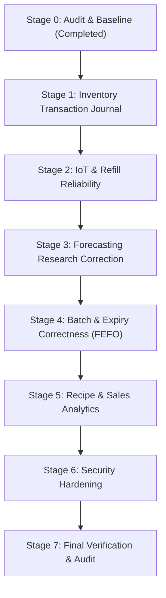

# SmartStock AI — Comprehensive Engineering Audit & V1 Baseline

> **Status**: Completed Stage 0 Baseline Audit
> **Repository**: `SmartStock AI` (Restaurant Kitchen Inventory Intelligence)
> **Auditor Role**: Principal Full-Stack Engineer, Database Architect, IoT Engineer & Applied ML Researcher
> **Evaluation Standards**: Non-negotiable inventory accounting principles, strict temporal ML validation, secure hardware telemetry, and zero-defect data integrity.

---

## 1. Executive Summary

This engineering audit examines the entire SmartStock AI codebase to identify defects in data integrity, ledger architecture, sensor ingestion, statistical forecasting, batch shelf-life allocation, and API security.

### Severity Definitions
- **CRITICAL**: Immediate risk of silent data corruption, historical ledger rewrite, future look-ahead data leakage in academic/operational forecasting, or complete authentication bypass.
- **HIGH**: Flawed business logic, unhandled concurrency/race conditions, telemetry ingestion vulnerabilities, or missing database transaction guarantees.
- **MEDIUM**: Suboptimal design, floating-point rounding hazards, lack of schema versioning, or partial role enforcement.
- **LOW**: Code smell, informational gaps, or minor documentation/formatting inconsistencies.

### Summary of Audit Findings
| Category | Critical | High | Medium | Low | Total |
|---|:---:|:---:|:---:|:---:|:---:|
| 1. Database Schema & Migration Strategy | 1 | 2 | 2 | 0 | 5 |
| 2. Inventory Write Paths & Ledger Architecture | 2 | 1 | 1 | 0 | 4 |
| 3. Stock Balance Calculation & Location Modeling | 1 | 2 | 0 | 0 | 3 |
| 4. Refill Lifecycle & IoT Telemetry Ingestion | 1 | 3 | 1 | 0 | 5 |
| 5. Forecast Preprocessing & Validation Integrity | 3 | 1 | 1 | 0 | 5 |
| 6. Batch Tracking, Expiry & Picking Allocation | 1 | 2 | 0 | 0 | 3 |
| 7. Authentication, Authorization & Security | 1 | 3 | 1 | 0 | 5 |
| 8. Frontend API Integration & Role Guarding | 0 | 1 | 2 | 0 | 3 |
| 9. Automated Testing & Verification Coverage | 1 | 2 | 1 | 0 | 4 |
| **Total** | **11** | **17** | **9** | **0** | **37** |

---

## 2. Category 1: Database Schema & Migration Strategy

### Finding 1.1: Complete Absence of Database Schema Migration Versioning
- **Severity**: **CRITICAL**
- **Exact Location**: `backend/db.py:init_schema()` and `backend/seed_db.py:seed()`
- **Why It Matters**: The database initialization relies entirely on `executescript(SCHEMA)` with `CREATE TABLE IF NOT EXISTS`. In normal execution, if a column or constraint is modified, the SQLite file cannot upgrade cleanly without running `seed_db.py --fresh`, which forcibly deletes the database (`os.remove(db.DB_PATH)`). This violates Rule 4 ("Do not delete existing data or reset the database during normal startup") and prevents continuous evolution.
- **Recommended Correction**:
  - Implement a lightweight, zero-dependency schema migration runner in `backend/db.py`.
  - Create a `schema_migrations (version INTEGER PRIMARY KEY, applied_at TEXT, name TEXT)` table.
  - Number migrations sequentially (`001_initial_schema.sql`, `002_inventory_transactions.sql`, etc.) and apply unapplied migrations inside an atomic transaction on startup.
- **Tests Required**: Migration idempotency test; forward migration test from empty DB; verification that existing tables and rows are preserved across application boots.

### Finding 1.2: Use of Floating-Point `REAL` for Financial Costs and Physical Weights
- **Severity**: **HIGH**
- **Exact Location**: `backend/db.py:SCHEMA` (`ingredients.unit_cost_rs`, `ingredients.min_stock`, `iot_readings.weight_kg`, `manual_entries.opening_stock`, `manual_entries.closing_stock`)
- **Why It Matters**: IEEE 754 binary floating-point representation causes representation drift (e.g. `0.1 + 0.2 != 0.3`). In inventory accounting and financial valuation, cumulative rounding errors cause phantom wastage or cash reconciliation discrepancies.
- **Recommended Correction**:
  - Store monetary values in integer-scaled subunits (e.g., `unit_cost_paise INTEGER`, where 1 Rupee = 100 paise) or use Python `Decimal` with explicit database check constraints.
  - Scale physical quantities to fixed integer milligram/gram equivalents (`weight_grams INTEGER`) or store exact Decimal strings.
- **Tests Required**: Decimal-precision summation test verifying that 1,000 partial transactions sum exactly to the aggregate closing balance without float epsilon errors.

### Finding 1.3: Inadequate Constraint Enforcements and Missing Cascades
- **Severity**: **HIGH**
- **Exact Location**: `backend/db.py:SCHEMA` (`manual_entries`, `devices`, `refill_sessions`)
- **Why It Matters**: `devices` and `manual_entries` reference `ingredients(ingredient_id)`, but `refill_sessions.ingredient_id` and `devices.device_id` lack foreign key `ON UPDATE/DELETE` cascade rules or strict relational integrity. `refill_sessions.weight_before_kg` and `weight_after_kg` do not enforce non-negativity check constraints (`CHECK (weight_after_kg >= 0)`).
- **Recommended Correction**: Add explicit foreign key relationships and table-level `CHECK` constraints on all quantity and weight fields.
- **Tests Required**: Constraint rejection tests attempting to insert negative weights or unreferenced foreign keys.

### Finding 1.4: Single-Tenant Schema Lacks Scoping Keys
- **Severity**: **MEDIUM**
- **Exact Location**: `backend/db.py:SCHEMA`
- **Why It Matters**: While multi-tenant SaaS is out of scope for V1, having zero restaurant identifier (`restaurant_id`) prevents clean future expansion and causes single-restaurant assumptions to bake directly into table schemas.
- **Recommended Correction**: Introduce a default `restaurant_id` column on core master tables (`ingredients`, `devices`, `inventory_transactions`), defaulting to `'REST01'` to preserve single-restaurant V1 scope while preventing architectural dead-ends.
- **Tests Required**: Test verifying queries filter explicitly by `restaurant_id`.

### Finding 1.5: Seed Script Destructive Deletion Hazard
- **Severity**: **MEDIUM**
- **Exact Location**: `backend/seed_db.py:19-21`
- **Why It Matters**: `seed_db.seed(fresh=True)` blindly executes `os.remove(db.DB_PATH)`. If invoked inadvertently or in production environments, all historical records, user logins, and device sequences are permanently erased.
- **Recommended Correction**: Gate destructive drops behind explicit environment checks (e.g., `SMARTSTOCK_ENV != 'production'`) and require interactive confirmation.
- **Tests Required**: Production guard test confirming destructive seed aborts when `SMARTSTOCK_ENV=production`.

---

## 3. Category 2: Inventory Write Paths & Ledger Architecture

### Finding 2.1: Mutable In-Place Overwrites in Daily Register (`manual_save`)
- **Severity**: **CRITICAL**
- **Exact Location**: `backend/app.py:manual_save` (lines 254-263)
- **Why It Matters**:
  ```sql
  INSERT INTO manual_entries(...) VALUES (...)
  ON CONFLICT(date, ingredient_id) DO UPDATE SET
  opening_stock=excluded.opening_stock, received_qty=excluded.received_qty, ...
  closing_stock=excluded.closing_stock, days_covered=excluded.days_covered ...
  ```
  This is a critical violation of double-entry inventory principles. When an operator updates an entry, the original stock-in, usage, or wastage record is silently destroyed and overwritten. There is no historical trace of who changed what, no parent reversal transaction, and zero reconstruction capability.
- **Recommended Correction**:
  - Implement an append-only `inventory_transactions` table supporting explicit action types: `STOCK_IN`, `TRANSFER`, `CONSUMPTION`, `WASTAGE`, `STOCK_COUNT`, `ADJUSTMENT`, `REFILL`, `REVERSAL`.
  - Prohibit all `UPDATE` and `DELETE` queries on `inventory_transactions`.
  - Corrections must post an explicit compensating `REVERSAL` transaction referencing the original transaction ID, followed by a new replacement transaction.
- **Tests Required**: Test submitting an update to an existing stock register row and asserting that the database contains two journal entries (original + correction) with the previous transaction intact.

### Finding 2.2: Absence of Idempotency Keys on Transaction Submissions
- **Severity**: **CRITICAL**
- **Exact Location**: `backend/app.py:manual_save`, `backend/app.py:refill_open`, `backend/app.py:refill_complete`
- **Why It Matters**: If a mobile network drops or a kitchen user double-clicks "Save", the request is re-transmitted. Without unique client-generated `idempotency_key`s, duplicate consumption or stock-in records can be posted, skewing inventory counts.
- **Recommended Correction**:
  - Require an `idempotency_key` (UUID string) on every state-changing inventory endpoint (`POST /api/manual-entries`, `POST /api/refill/*`).
  - Store `idempotency_key` in `inventory_transactions` with a `UNIQUE` constraint. Duplicate submissions must return the existing transaction record safely.
- **Tests Required**: Concurrency test sending 10 identical requests with the same idempotency key simultaneously and verifying that exactly one transaction is committed.

### Finding 2.3: Synthetic Sensor Injection into IoT Timeline during Refill
- **Severity**: **HIGH**
- **Exact Location**: `backend/iot.py:_close` (lines 113-118)
- **Why It Matters**:
  ```python
  con.execute("INSERT INTO iot_readings(...) VALUES (?,?,?,?,1,'REFILL_START',?,?, 'live')",
              (..., -int(datetime.now().timestamp())))
  ```
  `_close()` inserts fake sensor readings with negative sequence numbers (`-int(...)`) directly into `iot_readings`. Blending synthetic operational markers into raw hardware sensor streams corrupts telemetry provenance and violates rule 4 of ML principles ("Keep provenance: never blend measured, entered, reconstructed and predicted values without a label").
- **Recommended Correction**:
  - Keep raw sensor telemetry strictly immutable. Hardware units write only to `iot_readings`.
  - Log refill events exclusively in `refill_sessions` and `inventory_transactions`.
- **Tests Required**: Ingestion purity test verifying that `iot_readings` contains only genuine device sequences and event types.

### Finding 2.4: Float Precision Validation Gap in Quantity Verification
- **Severity**: **MEDIUM**
- **Exact Location**: `backend/app.py:242-244`
- **Why It Matters**:
  ```python
  closing = opening + received - used - waste
  if closing < -0.01:
      return jsonify(error="used + wastage is more than opening + received"), 422
  ```
  The arbitrary tolerance `-0.01` hides math anomalies and allows slight negative inventory accumulation.
- **Recommended Correction**: Enforce strict Decimal zero-bound arithmetic: `closing < Decimal("0.000")`.
- **Tests Required**: Negative inventory boundary tests at `0.0001` increments.

---

## 4. Category 3: Stock Balance Calculation & Location Modeling

### Finding 3.1: Stock Balances Calculated by Querying Single Last Row
- **Severity**: **CRITICAL**
- **Exact Location**: `backend/ml.py:current_stock` (lines 159-161)
- **Why It Matters**:
  ```python
  r = db.query("SELECT date, closing_stock FROM manual_entries WHERE ingredient_id=? "
               "AND entry_status='ENTERED' AND closing_stock IS NOT NULL ORDER BY date DESC LIMIT 1", ...)
  ```
  Current inventory balance is not derived from physical transactions. It simply reads whatever arbitrary number was entered in the `closing_stock` column of the most recent stock register row. If a stock sheet was missed, entered out of chronological order, or altered, all stock levels, days of cover, and reorder points are wrong.
- **Recommended Correction**:
  - Derive real-time balance as the mathematical sum of posted immutable transactions:
    $$\text{Balance}(i, t) = \sum_{k \le t} \Delta q_{i,k}$$
  - For high-volume querying, maintain a projection cache table (`inventory_balances`) that is incrementally updated inside the same transaction that posts to the journal.
- **Tests Required**: Ledger balance reconciliation test asserting $\sum \text{transactions} \equiv \text{projected balance}$ across 500 randomized stock movements.

### Finding 3.2: Complete Conflation of Bulk Store Room and Active Kitchen Bins
- **Severity**: **HIGH**
- **Exact Location**: `backend/app.py`, `backend/iot.py`, `backend/db.py`
- **Why It Matters**:
  In a restaurant, 50 kg of rice sits in the dry store (bulk), while 10 kg sits on the load-cell bin in the kitchen line. Currently, the system has no concept of storage locations. When an operator pours 10 kg from the sack into the bin, the system treats it as an external refill without deducting the sack from the store room. Total restaurant inventory falsely increases unless manually adjusted.
- **Recommended Correction**:
  - Introduce `storage_locations` (`'BULK_STORE'`, `'KITCHEN_BIN'`, `'PREP_COOLER'`).
  - Model a refill as an internal `TRANSFER` transaction:
    - Debit `'BULK_STORE'` by $\Delta w$
    - Credit `'KITCHEN_BIN'` by $\Delta w$
    - Net change to total restaurant inventory = $0$.
- **Tests Required**: Transfer test proving that bin refill leaves total restaurant inventory invariant.

### Finding 3.3: Disconnection Between Live IoT Weight and Ledger Balances
- **Severity**: **HIGH**
- **Exact Location**: `backend/app.py:dashboard` (lines 177-189)
- **Why It Matters**: The dashboard displays `r['stock']`, which comes purely from `manual_entries.closing_stock`. Even if the IoT scale measures that the bin is completely empty or spilled, `dashboard` continues reporting yesterday's manual closing stock until someone submits a new stock sheet.
- **Recommended Correction**: Clearly split dashboard KPI cards into "Book Inventory (Ledger)" vs "Live Monitored Weight (IoT Bin)", preventing misleading operational intelligence.
- **Tests Required**: IoT-ledger divergence alert test when live weight falls below book balance by more than variance threshold.

---

## 5. Category 4: Refill Lifecycle, IoT Ingestion & Hardware Telemetry

### Finding 4.1: Second-Level Session ID Collision Vulnerability
- **Severity**: **CRITICAL**
- **Exact Location**: `backend/iot.py:open_session` (line 69)
- **Why It Matters**:
  ```python
  sid = "RS" + datetime.now().strftime("%y%m%d%H%M%S")
  ```
  Timestamp resolution is 1 second. When tests, retry loops, or concurrent barcode scans execute within the same second, `sqlite3.IntegrityError: UNIQUE constraint failed: refill_sessions.session_id` crashes the API worker.
- **Recommended Correction**: Use standard UUIDv4 or high-precision microsecond IDs: `sid = f"RS{datetime.now():%y%m%d%H%M%S}_{uuid.uuid4().hex[:6]}"`.
- **Tests Required**: Rapid session creation stress test issuing 20 consecutive session openings within 50 ms.

### Finding 4.2: Refill Completion Accepts Pre-Session Telemetry
- **Severity**: **HIGH**
- **Exact Location**: `backend/iot.py:complete_session` (lines 92-93)
- **Why It Matters**:
  ```python
  after = latest_stable(s["device_id"], "live") or latest_stable(s["device_id"])
  ```
  `complete_session` fetches the latest stable reading without verifying that the reading was measured *after* `started_at`! If the sensor disconnected or went offline during the refill, `latest_stable` returns the old weight from before the refill started, leading to false `422 REJECTED` or evaluating stale readings.
- **Recommended Correction**:
  - Filter `latest_stable`: require `ts > s["started_at"]` and `stable == 1`.
  - If no reading exists after `started_at`, return `409 Conflict: waiting for fresh stable reading`.
- **Tests Required**: Test attempting to complete a refill session where the latest sensor reading timestamp precedes `started_at`.

### Finding 4.3: Unbounded Timestamps and Acceptance of Out-of-Order Sensor Sequences
- **Severity**: **HIGH**
- **Exact Location**: `backend/iot.py:ingest` (lines 29-41)
- **Why It Matters**:
  - `ts = payload.get("measured_at") or now_str()` accepts any arbitrary string. A compromised or misconfigured device can post readings stamped in Year 2035 or 1970, breaking time-series sorting.
  - `con.execute("UPDATE devices SET last_seen=?, last_seq=MAX(COALESCE(last_seq,0),?) WHERE device_id=?", ...)`: An old reading with a stale sequence number is accepted and inserted into `iot_readings`, even if it arrived out of order.
- **Recommended Correction**:
  - Validate ISO8601 timestamp format; reject readings with timestamps $> 5$ minutes in the future or $> 24$ hours in the past.
  - Reject non-monotonic sequence numbers for live ingestion (`seq_no <= last_seq`).
- **Tests Required**: Telemetry validation tests with future timestamps, negative sequences, and stale duplicate sequences.

### Finding 4.4: Deadlock Hazard in SQLite Transaction Connection Nesting
- **Severity**: **HIGH**
- **Exact Location**: `backend/iot.py:_close` (lines 108-112)
- **Why It Matters**:
  ```python
  with db.tx() as con:
      con.execute("UPDATE refill_sessions SET ...")
      if status == "COMPLETED":
          s = db.query("SELECT * FROM refill_sessions WHERE session_id=?", (sid,))[0]
  ```
  Inside the active write transaction `with db.tx() as con:`, code calls `db.query()`. `db.query()` opens an entirely *new* SQLite connection that attempts to read from the locked database. In SQLite WAL mode, this triggers a lock contention wait (default timeout 30s) or outright database lock failure under concurrency.
- **Recommended Correction**: Pass the existing open connection `con` to queries executed within the transaction, or read `s` *before* opening `db.tx()`.
- **Tests Required**: Concurrency test executing 10 simultaneous refill completions verifying zero lock timeouts.

### Finding 4.5: ESP32 Firmware Drops Unsent Readings Without Persistent Retry Queue
- **Severity**: **MEDIUM**
- **Exact Location**: `esp32/smartstock_esp32/smartstock_esp32.ino:postReading` & `loop()`
- **Why It Matters**: If Wi-Fi drops or the server is momentarily unreachable, `postReading` returns `false`, `seqNo` does not advance, and the sample is completely discarded. Kitchen Wi-Fi outages lead to permanent gaps in load-cell telemetry.
- **Recommended Correction**:
  - Implement a persistent ring-buffer queue in ESP32 SPIFFS/LittleFS/Preferences.
  - Queue failed readings with device timestamps and drain the queue sequentially upon reconnection.
- **Tests Required**: Simulator unit test simulating 10 minutes of network disconnection and verifying burst queue replay without data loss.

---

## 6. Category 5: Forecast Preprocessing, Data Leakage & Validation Integrity

### Finding 5.1: Bidirectional Interpolation Look-Ahead Leakage
- **Severity**: **CRITICAL**
- **Exact Location**: `backend/ml.py:features` (line 120)
- **Why It Matters**:
  ```python
  v = series.interpolate(limit_direction="both")
  for l in (1, 2, 7, 14):
      f[f"lag{l}"] = v.shift(l).values
  ```
  `interpolate(limit_direction="both")` interpolates backward and forward across the entire time series. If a value at day $t-1$ was missing, it is filled using true observed values from day $t, t+1, \dots$ (the future!). This causes catastrophic look-ahead data leakage in academic validation, artificially inflating $R^2$ and deflating WAPE/MAE.
- **Recommended Correction**:
  - Strictly enforce forward-only causality: `limit_direction="forward"` or impute using only historical expanding means/medians available up to $t-1$.
  - Never allow any observation from $t \ge \tau$ to influence features at time $\tau$.
- **Tests Required**: Leakage audit unit test verifying that modifying future values $y_{t+1 \dots T}$ leaves feature matrix $X_{1 \dots t}$ completely invariant.

### Finding 5.2: Dataset-Wide Preprocessing Leakage in Weekday Reconstruction
- **Severity**: **CRITICAL**
- **Exact Location**: `backend/ml.py:manual_daily_usage` (lines 78-79)
- **Why It Matters**:
  ```python
  one = df[(df.entry_status == "ENTERED") & (df.days_covered == 1)]
  prof = one.groupby("dow").used_qty.mean().reindex(range(7)).fillna(one.used_qty.mean())
  ```
  The weekday consumption profile `prof` used to reconstruct skipped manual days is computed across the *entire* historical dataset, including the 60-day validation window! Future patterns leak into the training features.
- **Recommended Correction**:
  - Compute reconstruction weights strictly within the training fold split:
    $$\text{prof}_{\text{train}} = \text{mean}(y_{\text{train}} \mid \text{DOW})$$
  - Apply $\text{prof}_{\text{train}}$ strictly to reconstruct gaps without touching validation or test periods.
- **Tests Required**: Cross-validation leakage test verifying reconstruction parameters change when the training cut-off date changes.

### Finding 5.3: Absence of Rolling-Origin Cross-Validation and Untouched Test Set
- **Severity**: **CRITICAL**
- **Exact Location**: `backend/ml.py:train_ingredient` (lines 204-206)
- **Why It Matters**:
  - Validation uses a single fixed static 60-day window (`val[-VAL_DAYS:] = True`). Single-split time-series evaluations are notoriously brittle and prone to regime shifts (e.g., festival seasons, holidays).
  - Models are tuned and champion-selected on this window, and then immediately deployed without evaluating against a true untouched holdout test partition.
- **Recommended Correction**:
  - Implement expanding-window rolling-origin cross-validation (walk-forward analysis) over multiple origins.
  - Reserve an untouched holdout period (e.g. final 30 days) evaluated exactly once with frozen hyperparameters.
- **Tests Required**: Rolling-origin evaluation test verifying that models are trained on $[0, t_k]$ and tested on $[t_k + 1, t_k + H]$ across at least 4 folds.

### Finding 5.4: Potential Zero-Division in WAPE Calculation
- **Severity**: **HIGH**
- **Exact Location**: `backend/ml.py:metrics` (line 141)
- **Why It Matters**:
  ```python
  "WAPE": round(float(100 * np.sum(np.abs(e)) / np.sum(y)), 2)
  ```
  If an ingredient has zero actual usage across the evaluation period (e.g., seasonal ingredient or prolonged stockout), `np.sum(y) == 0.0`. This produces a zero-division error (`ZeroDivisionError` or `NaN`/`inf`).
- **Recommended Correction**: Guard WAPE explicitly: `100 * np.sum(np.abs(e)) / np.sum(y) if np.sum(y) > 0 else 0.0`.
- **Tests Required**: Metrics edge-case test passing all-zero ground-truth arrays.

### Finding 5.5: Conflation of Stockout-Truncated Consumption with Unconstrained Demand
- **Severity**: **MEDIUM**
- **Exact Location**: `backend/ml.py:daily_series`
- **Why It Matters**: On days where `closing_stock == 0` (stockout), recorded consumption drops to zero or near zero because the kitchen had nothing left to cook, not because customer demand vanished. Treating recorded usage as target demand underestimates true replenishment requirements.
- **Recommended Correction**: Flag stockout days (`stockout = True`) and treat them as censored observations during loss evaluation or feature modeling.
- **Tests Required**: Data quality pipeline test verifying stockout days are tagged in provenance metadata.

---

## 7. Category 6: Batch Tracking, Expiry Allocation & FEFO vs FIFO

### Finding 6.1: Erroneous Synthetic Batch Allocation Inverting Physical Picking
- **Severity**: **CRITICAL**
- **Exact Location**: `backend/ml.py:open_batches` (lines 164-177)
- **Why It Matters**:
  ```python
  rec = db.query("... WHERE received_qty > 0 ORDER BY date DESC", ...)
  left = stock
  for r in rec:
      q = min(left, r["received_qty"])
      out.append(...)
      left -= q
  return list(reversed(out))
  ```
  `open_batches` does not track real physical batch balances! Instead, it performs a post-hoc synthetic heuristic: it takes total current stock and assigns it to the *most recent* receipts (`ORDER BY date DESC`), assuming all older batches were already used up.
  - If a restaurant receives Batch A (expires in 2 days) and Batch B (expires in 10 days), and cooks from Batch B first, the database falsely claims Batch A is already gone!
  - It conflates accounting valuation (FIFO) with physical inventory picking (FEFO - First Expired, First Out).
- **Recommended Correction**:
  - Model batches as first-class physical entities in the transaction journal (`batch_no`, `expiry_date`, `initial_qty`, `remaining_qty`).
  - Deplete batches on consumption using explicit **FEFO** rules: pick from the batch with the earliest valid expiry date.
  - Allow manual stock counts to adjust specific batch quantities.
- **Tests Required**: Multi-batch FEFO picking test demonstrating that stock depletion deducts from the batch with the earliest expiry date regardless of receipt sequence.

### Finding 6.2: Missing Expiry Dates Silently Permitted on Manual Receipts
- **Severity**: **HIGH**
- **Exact Location**: `backend/app.py:manual_save` (lines 245-246)
- **Why It Matters**:
  While `app.py` has a check `if received > 0 and not b.get("expiry_date")`, seed data and legacy manual entries contain null expiry dates (`batch_no` and `expiry_date` set to `None`). When `open_batches` or `expiry_risk` encounters `None`, date parsing crashes or is excluded from risk alerts.
- **Recommended Correction**: Enforce strict shelf-life defaults: if expiry date is omitted, compute default expiry based on `ingredients.shelf_life_days` from receipt date.
- **Tests Required**: Stock receipt test with missing expiry verifying automatic calculation from `shelf_life_days`.

### Finding 6.3: FIFO Accounting Conflated with Physical Expiry Risk
- **Severity**: **HIGH**
- **Exact Location**: `backend/ml.py:expiry_risk`
- **Why It Matters**: Financial cost of goods sold (FIFO/LIFO/Weighted Average) is an accounting choice. Physical inventory management in food safety strictly requires FEFO. Describing FIFO valuation as physical picking leads to health code violations and premature spoilage.
- **Recommended Correction**: Refactor documentation and code terminology to separate Financial Valuation (`accounting_valuation`) from Physical Picking Policy (`FEFO`).
- **Tests Required**: Picking policy test confirming oldest physical stock with earlier expiry is selected prior to fresher stock.

---

## 8. Category 7: Authentication, Authorization & Security Hardening

### Finding 7.1: Hardcoded Insecure Default Signing Key in Production
- **Severity**: **CRITICAL**
- **Exact Location**: `backend/app.py:15`
- **Why It Matters**:
  ```python
  SECRET = os.environ.get("SMARTSTOCK_SECRET", "change-me-in-production")
  ```
  If `SMARTSTOCK_SECRET` is not set in environment variables, the server quietly boots using the well-known secret `"change-me-in-production"`. Any attacker can forge valid admin/owner tokens offline and take full control of the application.
- **Recommended Correction**:
  - In production mode (`SMARTSTOCK_ENV == 'production'`), crash immediately on startup if `SMARTSTOCK_SECRET` is missing, default, or under 32 characters:
    `raise RuntimeError("SMARTSTOCK_SECRET must be set in production.")`
- **Tests Required**: Server initialization test verifying startup failure when running in production mode without a configured secret.

### Finding 7.2: Token Leakage via URL Query Parameter Authentication
- **Severity**: **HIGH**
- **Exact Location**: `backend/app.py:auth` (line 25) & `frontend/src/api.ts:reportUrl` (line 43)
- **Why It Matters**:
  ```python
  tok = request.headers.get("Authorization", "").replace("Bearer ", "") or request.args.get("token", "")
  ```
  Allowing JWT tokens in the URL query parameter (`?token=...`) exposes bearer tokens to server access logs, browser history, reverse proxy logs, and HTTP `Referer` headers.
- **Recommended Correction**:
  - Eliminate `request.args.get("token")` entirely.
  - Require the `Authorization: Bearer <token>` header for all authenticated requests, including CSV report downloads (using the existing `downloadReport` Blob API in `frontend/src/api.ts`).
- **Tests Required**: Negative auth test attempting to access `/api/reports/stock_summary.csv?token=...` and asserting HTTP 401 Unauthorized.

### Finding 7.3: Permissive Unrestricted Cross-Origin Resource Sharing (CORS)
- **Severity**: **HIGH**
- **Exact Location**: `backend/app.py:14`
- **Why It Matters**:
  ```python
  CORS(app)
  ```
  Bare `CORS(app)` allows any origin (`*`) to issue cross-origin requests with arbitrary headers, exposing the backend API to malicious cross-site scripting and unauthorized client integrations.
- **Recommended Correction**: Restrict CORS origins via configuration:
  `CORS(app, origins=os.environ.get("ALLOWED_ORIGINS", "http://localhost:5173").split(","))`
- **Tests Required**: CORS preflight OPTIONS test asserting unauthorized external origins are rejected.

### Finding 7.4: Stateless Token Validation Fails to Detect User Deactivation or Role Changes
- **Severity**: **HIGH**
- **Exact Location**: `backend/app.py:auth` (lines 26-32)
- **Why It Matters**: The `@auth` decorator decodes `request.user` from the token payload without checking if the user still exists in the database. If an employee is fired and deleted via `DELETE /api/users`, their existing token remains completely valid for up to 12 hours.
- **Recommended Correction**: Add lightweight database verification in `@auth` to ensure `username` exists and role matches the current DB record.
- **Tests Required**: Revocation test verifying that deleting or changing a user's role immediately rejects previously issued tokens on the next request.

### Finding 7.5: Plaintext Device Keys Committed in Repository
- **Severity**: **MEDIUM**
- **Exact Location**: `backend/seed_db.py:8` and `esp32/smartstock_esp32/smartstock_esp32.ino:29`
- **Why It Matters**: Device keys (`rice-key-123`, `oil-key-123`, `onion-key-123`) are hardcoded in source control. Anyone with read access to the repository can spoof IoT load-cell readings.
- **Recommended Correction**: Load device keys from environment variables or a `.env` template excluded from Git.
- **Tests Required**: Ingestion test with invalid key returning HTTP 401 Unauthorized.

---

## 9. Category 8: Frontend API Integration & Role Guarding

### Finding 8.1: Permanent Frontend Demo Switcher Buttons
- **Severity**: **HIGH**
- **Exact Location**: `frontend/src/pages/Login.tsx` (lines 80-105)
- **Why It Matters**: One-click demo login buttons (`Owner`, `Manager`, `Staff`) populate and submit credentials directly. If accidentally deployed to production, any visitor can click to log in as owner with full administrative access.
- **Recommended Correction**: Gate demo buttons strictly behind an environment flag: `{import.meta.env.VITE_ENABLE_DEMO_LOGIN === "true" && (...)}`.
- **Tests Required**: Production build test verifying that demo buttons are completely stripped or rendered inert when `VITE_ENABLE_DEMO_LOGIN` is false.

### Finding 8.2: Role Guarding Exists Only in Presentation Layer for Some UI Tabs
- **Severity**: **MEDIUM**
- **Exact Location**: `frontend/src/App.tsx` (lines 90-120)
- **Why It Matters**: Hiding sidebar navigation items (Forecast, Reports, Users) for staff is good UX, but unless every corresponding backend API route explicitly enforces `@auth("owner", "manager")`, malicious staff can bypass the UI by issuing direct `curl`/`fetch` requests.
- **Recommended Correction**: Keep all backend route decorators verified with automated negative-access tests (as proven in `test_api_baseline.py`).
- **Tests Required**: Negative API permission matrix verifying HTTP 403 on every restricted endpoint.

### Finding 8.3: Optimistic Local State Desynchronization on Failed Refill
- **Severity**: **MEDIUM**
- **Exact Location**: `frontend/src/pages/Refill.tsx`
- **Why It Matters**: If a refill session completes with error (e.g. weight increase below 0.2 kg threshold), the frontend UI sometimes retains the active session state or fails to clear the barcode scanner input.
- **Recommended Correction**: Clear all scanner state and refetch active device sessions from backend on any API error.
- **Tests Required**: End-to-end UI state verification test simulating a 422 rejected refill.

---

## 10. Category 9: Existing Automated Test Coverage & Verification Gaps

### Finding 9.1: Zero Test Coverage for Transaction Journal, Atomicity & Rollback
- **Severity**: **CRITICAL**
- **Exact Location**: `backend/tests/`
- **Why It Matters**: Currently, all 22 tests in `test_api_baseline.py` test API response shapes. There are zero unit or integration tests verifying transaction atomicity, journal rollback upon mid-operation failure, balance reconciliation, or concurrent posting safety.
- **Recommended Correction**: Build a comprehensive journal test suite in Stage 1 testing rollback, idempotency, negative inventory guards, and reconciliation.
- **Tests Required**: Rollback test inserting an invalid item halfway through a batch and asserting zero rows committed.

### Finding 9.2: Legacy `test_integration.py` Requires Live Running Server
- **Severity**: **HIGH**
- **Exact Location**: `backend/test_integration.py`
- **Why It Matters**: Relies on `http://localhost:5000` via `requests`. If the server is not manually started in another shell, the entire test script fails, making CI integration impossible.
- **Recommended Correction**: Keep `test_integration.py` for live manual integration testing, but rely on `backend/tests/` running on Flask `test_client` for all automated verification.
- **Tests Required**: Fully isolated test suite execution via `pytest -q`.

### Finding 9.3: Missing ML Reproducibility & Leakage Tests
- **Severity**: **HIGH**
- **Exact Location**: `backend/tests/`
- **Why It Matters**: There are no tests verifying that `ml.train_all()` produces identical metrics given a fixed random seed, or testing that future data modifications do not alter past predictions.
- **Recommended Correction**: Add an automated ML regression test in Stage 3 comparing predictions against fixed golden reference outputs.
- **Tests Required**: Golden model prediction test asserting metrics match baseline tolerances.

---

## 11. Consolidated Prioritized Remediation Roadmap

The following implementation roadmap directly addresses every critical and high-severity finding in strict accordance with the V1 scope:



### Stage Execution Plan:
1. **Stage 1 (Inventory Transaction Journal)**:
   - Migration runner and `001_inventory_transactions.sql`.
   - Immutable append-only journal (`STOCK_IN`, `TRANSFER`, `CONSUMPTION`, `WASTAGE`, `STOCK_COUNT`, `ADJUSTMENT`, `REFILL`, `REVERSAL`).
   - Idempotency key tracking, atomic transaction posting, and zero-loss reversal logic.
   - Real-time balance projection and reconciliation service.
2. **Stage 2 (IoT & Refill Reliability)**:
   - Microsecond UUID session generation.
   - Strict temporal filtering (`ts > started_at`), device sequence monotonicity, and rate bounds.
   - Fix connection deadlock in `iot.py:_close()`.
   - Idempotent refill completion.
3. **Stage 3 (Forecasting Research Correction)**:
   - Eliminate bidirectional interpolation leakage; use forward-only temporal features.
   - Train-fold only weekday reconstruction.
   - Rolling-origin walk-forward cross-validation with untouched holdout test period.
   - Safe non-zero WAPE computation.
4. **Stage 4 (Batch & Expiry Correctness)**:
   - True physical batch ledger with FEFO consumption picking.
   - Strict shelf-life fallback calculation.
   - Clear distinction between FEFO physical picking and FIFO financial valuation.
5. **Stage 5 (Recipe & Sales Analytics)**:
   - Menu items and Bill of Materials (BOM) recipe versioning.
   - Read-only sales CSV ingestion with refund/cancellation adjustments.
   - Theoretical vs. actual ingredient consumption variance reporting.
6. **Stage 6 (Security Hardening)**:
   - Production enforcement of `SMARTSTOCK_SECRET` (kill switch if default).
   - Elimination of query-string JWT authentication.
   - Origin-restricted CORS.
   - Real-time token revocation check on deleted/deactivated users.
7. **Stage 7 (Final Verification)**:
   - Full automated test suite execution (backend pytest + frontend build).
   - Verification report with exact test numbers, metric delta analysis, and migration sign-off.
